<picture>
  <source media="(prefers-color-scheme: dark)" srcset="./assets/header-dark.svg">
  <source media="(prefers-color-scheme: light)" srcset="./assets/header-light.svg">
  
</picture>

 

I build for the web end to end, from the interface people touch to the systems underneath it.
I care about **fast, quiet, well-made software**: clear typography, honest UI and code that stays readable a year later.

 

<picture>
  <source media="(prefers-color-scheme: dark)" srcset="./assets/stack-dark.svg">
  <source media="(prefers-color-scheme: light)" srcset="./assets/stack-light.svg">
  
</picture>

  

<a href="https://github.com/eliasfruktsallad/vk-studio">
<picture>
  <source media="(prefers-color-scheme: dark)" srcset="./assets/info-dark.svg">
  <source media="(prefers-color-scheme: light)" srcset="./assets/info-light.svg">
  
</picture>
</a>

 

<picture>
  <source media="(prefers-color-scheme: dark)" srcset="./assets/divider-dark.svg">
  <source media="(prefers-color-scheme: light)" srcset="./assets/divider-light.svg">
  
</picture>

Thanks for stopping by.

