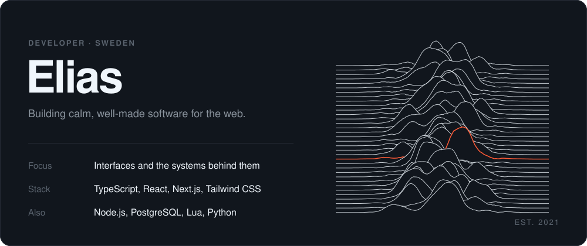
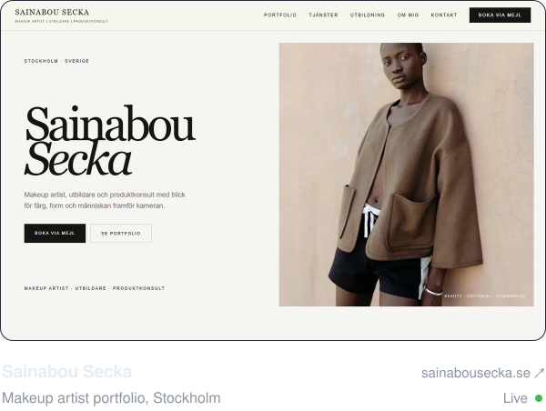
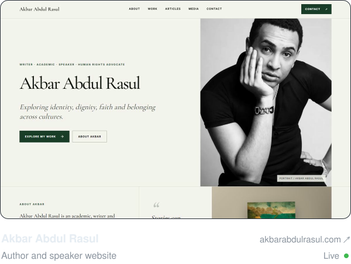
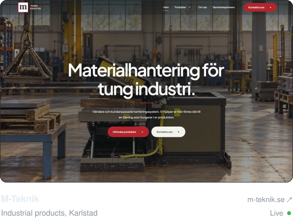
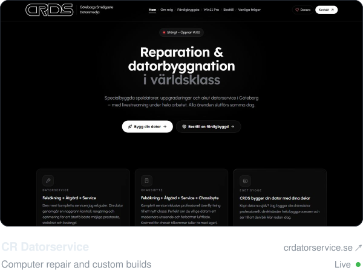
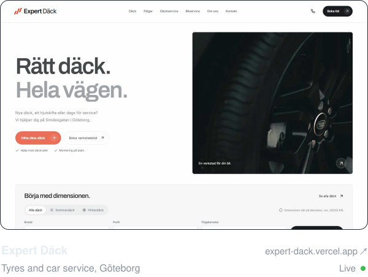
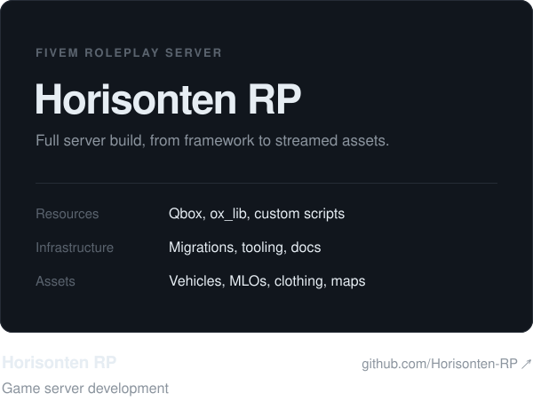
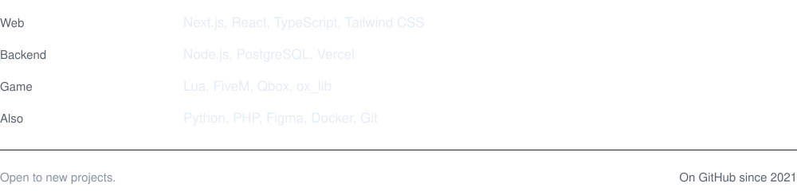

<picture>
  <source media="(prefers-color-scheme: dark)" srcset="./assets/hero-dark.svg">
  <source media="(prefers-color-scheme: light)" srcset="./assets/hero-light.svg">
  
</picture>

 

<picture>
  <source media="(prefers-color-scheme: dark)" srcset="./assets/work-dark.svg">
  <source media="(prefers-color-scheme: light)" srcset="./assets/work-light.svg">
  
</picture>

<a href="https://sainabousecka.se"><picture>
  <source media="(prefers-color-scheme: dark)" srcset="./assets/sainabou-dark.svg">
  <source media="(prefers-color-scheme: light)" srcset="./assets/sainabou-light.svg">
  
</picture></a>
&nbsp;
<a href="https://akbarabdulrasul.com"><picture>
  <source media="(prefers-color-scheme: dark)" srcset="./assets/akbar-dark.svg">
  <source media="(prefers-color-scheme: light)" srcset="./assets/akbar-light.svg">
  
</picture></a>

<a href="https://m-teknik.se"><picture>
  <source media="(prefers-color-scheme: dark)" srcset="./assets/mteknik-dark.svg">
  <source media="(prefers-color-scheme: light)" srcset="./assets/mteknik-light.svg">
  
</picture></a>
&nbsp;
<a href="https://crdatorservice.se"><picture>
  <source media="(prefers-color-scheme: dark)" srcset="./assets/crdator-dark.svg">
  <source media="(prefers-color-scheme: light)" srcset="./assets/crdator-light.svg">
  
</picture></a>

<a href="https://expert-dack.vercel.app"><picture>
  <source media="(prefers-color-scheme: dark)" srcset="./assets/expertdack-dark.svg">
  <source media="(prefers-color-scheme: light)" srcset="./assets/expertdack-light.svg">
  
</picture></a>
&nbsp;
<a href="https://github.com/Horisonten-RP"><picture>
  <source media="(prefers-color-scheme: dark)" srcset="./assets/horisonten-dark.svg">
  <source media="(prefers-color-scheme: light)" srcset="./assets/horisonten-light.svg">
  
</picture></a>

 

<picture>
  <source media="(prefers-color-scheme: dark)" srcset="./assets/stack-title-dark.svg">
  <source media="(prefers-color-scheme: light)" srcset="./assets/stack-title-light.svg">
  
</picture>

<picture>
  <source media="(prefers-color-scheme: dark)" srcset="./assets/stack-dark.svg">
  <source media="(prefers-color-scheme: light)" srcset="./assets/stack-light.svg">
  
</picture>
