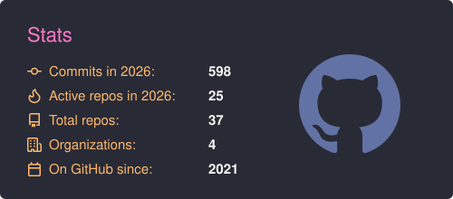
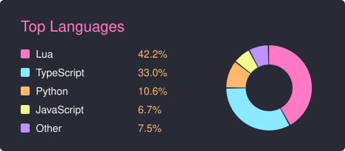

Hi, I'm Elias. I'm a web developer from Sweden who builds websites for businesses, and FiveM roleplay servers on the side.

Works with: `TypeScript` `React` `Next.js` `Tailwind CSS` `Node.js` `PostgreSQL` `Lua`

|||
|-----|------|

Above stats include private repositories, generated with [`scripts/generate.py`](scripts/generate.py).

# What I Do

1. **Websites for businesses** (Next.js, TypeScript)
   - Fast, hand-built sites for local companies: design, development and deployment, from the first sketch to launch.
2. **Game servers** (Lua)
   - FiveM roleplay servers built on Qbox: custom resources, in-game interfaces, database migrations and deploy tooling.
